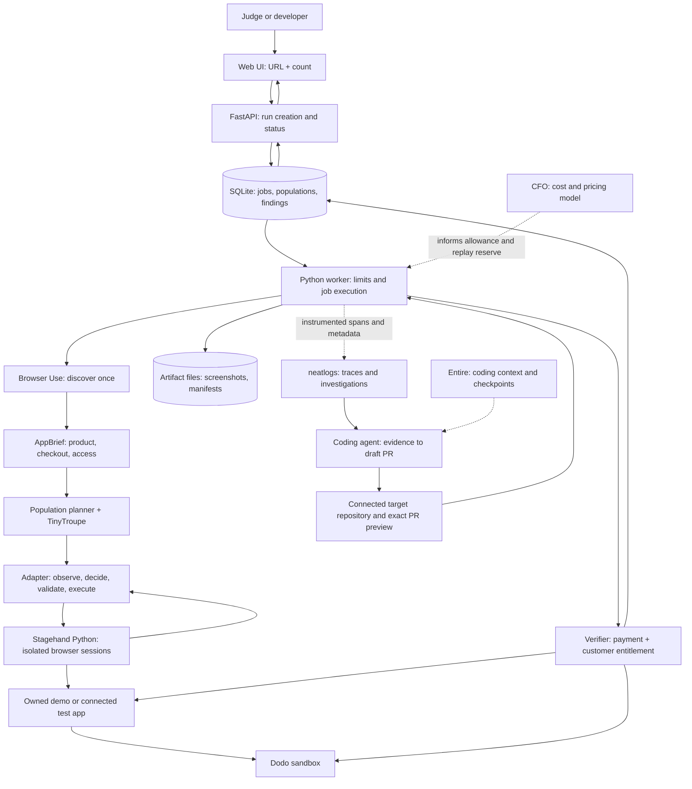
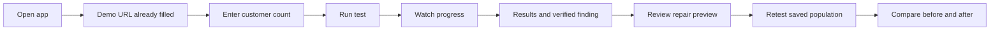

# TryFolk: architecture and experience
Date: 2026-10-10
Status: proposed hackathon architecture. A local frontend prototype exists with simulated journeys; real testing and repair integrations are not established as implemented.
TryFolk is the accepted product name. The selected direction uses human crowds, a central product snapshot, and individual customer stories. `designs/tryfolk.html` is the complete interactive frontend reference; its execution and evidence are simulated.

## Product contract
Every new run takes exactly two user inputs: app URL and number of personas.
TryFolk gives a product its first varied synthetic customers. The system discovers the app, generates customers, lets them choose actions, executes actual browser interactions, and finds who cannot complete payment and receive the purchased capability. It investigates the evidence and prepares an evidence-backed draft PR on the authorized connected target repository. Before owner merge review, saved customers test the exact PR preview under equivalent starting conditions. A report or generated patch alone is not the end-to-end outcome.
People can inspect generated customers after generation. They do not select the population or manually describe every journey.
A persona is one synthetic customer with a goal, background, preferences, behaviour, memory, and isolated test identity. One journey can contain revisits, retries, or abandonment.
Personas are simulated customers. Their abandonment is not measured real customer churn.

## Visitor access
The hackathon homepage opens into a preconfigured, owned Dodo sandbox app. Judges can run it without supplying credentials or creating an account.
The initial proposed public allowance is 1-20 customers per run, default 10. The real ceiling must be set from measured cost and the event budget before launch.
The numeric input exposes the current allowance. An unaffordable request is explained before execution. Never silently reduce the requested count.
A connected owner can request larger populations, including thousands, subject to their allowance. Queued, generated, executed, and blocked counts are separate.
Public guests receive an expiring run-scoped access token. They can read their own results and restart or retest within their allowance.
Own-app URLs use a previously saved AppConnection. An unknown URL gets a discovery-only assessment and a clear connection-required outcome before any payment mutation.
A URL by itself cannot expose private payment records, change webhook delivery, or authorize repository repair. Enter our deployed demo URL in the same App URL field; its repository, sandbox credentials, test identities, verifier, and preview connection are configured once behind that URL. A payment link alone cannot establish post-purchase product access, and a repository URL alone is not a running application. Discovery-only results must not promise full verification or repair.

## System architecture


## Deployment
One repository contains a small static frontend, FastAPI, and worker code.
Deploy the API and worker as separate processes on one long-running host with a persistent volume for SQLite and artifacts. They can share one container or host in the hackathon version.
The worker can keep executing after the HTTP request returns. A server restart marks unfinished browser sessions interrupted; saved state alone does not imply the same browser can resume.
Start with one worker and sequential customer execution. Add a small bounded pool after the decision loop is proven, isolating TinyTroupe runtime state between jobs where needed.
Browser Use discovery can use its hosted API. Stagehand needs actual browser sessions; use a supported hosted browser setup for the public demo, and pin the tested SDK versions.
LLM and browser credentials remain server-side. Use providers compatible with the selected SDK versions; do not add a second agent framework.
The target Dodo demo remains a separate Next.js application with its existing MongoDB. That database stores target-app users and entitlements; SQLite stores our test runs.
Use our own copy of [dodopayments/dodo-checkout-demo](https://github.com/dodopayments/dodo-checkout-demo) as the chosen target, deployed with Dodo sandbox. The Demo target and setup gates section defines its baseline, test login, payment verification, and reset gates. Target deployment and baseline verification remain planned until completed and evidenced.

## Logical modules
| Module | Owns |
|---|---|
| Run API | Validated URL/count, guest run token, run creation, status and cancellation |
| Connection registry | Approved target origins, test login fixtures, sandbox provider access, entitlement verifier, optional repo/preview |
| Discovery | Observed app facts, flow entry points, visible product promises, blockers, evidence links |
| Population planner | Relevant diversity dimensions, deduplication, persona generation, executable condition assignments |
| Customer adapter | Actual observations, one validated external action at a time, tool dispatch, limits, terminal decisions |
| Fixtures | Per-customer accounts and starting states, supported browser/network conditions, sandbox fault hooks |
| Outcome verifier | Authoritative payment state, expected entitlement, account correlation, bounded settlement waiting |
| Failure investigation | Reproduction, fresh-account controls, one-condition variations, observed affected scope |
| Evidence writer | Run/persona/action IDs, screenshots, sanitized events, linked neatlogs spans |
| Repair coordinator | Finding evidence, isolated repair branch, validation, draft PR/base/head, exact preview, replay/retest evidence, owner review |
| Cost controller | Measured spending, estimated remaining spend, concurrency, per-run cap and retest reserve |

These are modules in the same project, not separate microservices.

## Run pipeline
1. Validate the URL, numeric count, target connection, and run allowance.
2. Persist the run and return its run ID immediately.
3. Discover the app once. Cache the AppBrief by target/version and re-discover after a meaningful deployment change.
4. Generate N relevant customer profiles in batches. Save them before execution.
5. Assign executable starting conditions using the fixtures that this connection actually supports.
6. For each customer, provision an isolated test account and browser session.
7. Observe actual UI and visible errors, ask TinyTroupe for one next action, validate it, execute through Stagehand, and supply the real result back.
8. Save every action and result. Stop on customer completion, abandonment, a blocker, cancellation, step/time limits, or budget.
9. Independently verify payment and access, allowing the configured time for settlement.
10. Group findings, keep automation errors separate, and use a bounded investigation reserve for reproduction and controls.
11. Save scope evidence and display partial or unresolved conclusions when the reserve cannot establish a cause.

## Population generation
Discovery supplies facts about this app. General checkout-risk dimensions supply candidate conditions. TinyTroupe supplies relevant human variation and decisions.
Generate automatically across goals, patience, confidence, device/locale, geography, account history, and behaviour. Do not use age or geography alone as a prediction of a customer's actions.
Avoid duplicate profiles and duplicate condition assignments where possible. Preserve the first population when the count increases. Additional customers should explore underrepresented supported conditions and paths rather than merely new biographies. Record assigned conditions separately from those actually exercised; report distinct conditions exercised alongside customer counts, verified findings, and incomplete outcomes. Synthetic outcomes are not statistically representative real conversion rates.
A bio saying "slow internet" does not create slow internet. The fixture layer must implement the condition. Unsupported conditions are explicitly untested.
Locale or billing country is not equivalent to IP geography. Country-specific eligibility claims need a supported browser/network/payment fixture.
The population expands distinct supported combinations as count increases; it does not promise to cover every edge case or find a new bug for every extra customer.
An attacker-like profile only exercises scoped test fixtures in an owned sandbox. A personality description is not a security audit.
External persona datasets are optional research inputs. No Tencent Persona Hub dataset is required for this MVP.
After a failure, propose nearby variations based on the observed evidence. Execute supported variants within the investigation reserve and record the original finding, parent run, generation reason, and changed dimension. Deduplicate by condition and starting state as well as biography. Diagnostic personas have a separate population lineage and attempt count; they do not alter the original requested N or its comparison denominator.

## App discovery record

The AppBrief stores observed product description, plans/prices, signup and checkout entry points, observed payment methods, expected paid capability, source URLs/screenshots, target version, and blockers. Store inferred audience descriptions separately from observed facts. Reuse the brief for the run; refresh it after a relevant target deployment change.

## Decision loop
```text
Stagehand reads visible state and actionable elements
  -> adapter builds the customer's observation
  -> TinyTroupe produces the next action intent
  -> adapter validates target/action and dispatches once
  -> Stagehand executes the browser action
  -> actual result updates customer memory
  -> verifier checks backend truth separately
```

Use TinyTroupe's custom action/faculty extension to collect decisions. The outer worker performs asynchronous browser calls.
Map observed browser actions to stable per-observation IDs, and allow controlled intents such as fill, wait, back, refresh, finish, or abandon.
Validate one external action per fresh observation. TinyTroupe's n=1 argument alone must not be assumed to enforce this contract.
A model's narration that it purchased something is not evidence of a purchase.
Payment-submit retries are deliberate customer actions. A generic exception retry must not automatically repeat an ambiguous payment mutation.
A tool timeout is not automatically customer abandonment.
Give the customer only facts that a customer can perceive. Backend payment truth belongs to verification and diagnosis.

## Verification and findings
For each journey correlate run ID, persona ID, test-account ID, checkout/payment ID, and expected purchased entitlement.
Read provider payment status and that same account's app entitlement independently. The payment oracle and entitlement lookup must be read-only; a status endpoint that also grants access can erase the defect. Exercise the purchased capability in the browser separately and identify any intentional state mutation.
Freeze the target revision and fault configuration for each run. Keep healthy, deliberately broken, and repaired previews separate, isolate test accounts, and reset only run-owned state so concurrent visitors cannot contaminate comparisons.
Classify:
- Passed: expected outcome, including a correctly handled declined test payment.
- Verified defect: actual app invariant violated with supporting evidence.
- Abandoned: simulated customer stopped, with observed reasons and payment-state follow-up.
- Automation error: browser/tool execution failed or targeted the wrong element.
- Blocked/inconclusive: login, challenge, unavailable verifier, unknown settlement, or unsupported condition.
Use a bounded settlement window before diagnosing delayed access. Keep pending and confirmed states distinct.
Evidence includes the last relevant screenshot, browser steps, payment state, entitlement state, timing, condition, expected behaviour, and neatlogs trace reference.

## Failure scope and investigation

Investigate a verified failure before generalizing its scope:

1. Reproduce the original steps from an equivalent account/session/payment state on the same target version.
2. Repeat with fresh accounts holding the same relevant history. Record whether the original identity itself is required.
3. Compare passing controls and change one dimension per probe, such as trial versus new account, mobile versus desktop, or expired versus current session.
4. Compare payment/access records, browser observations, traces, and the affected code branch. Treat suspected causes as hypotheses until supported.
5. Save the matrix of attempted conditions, failures, passes, and inconclusive results, with links to evidence.

Scope labels describe tested evidence: account-specific, group-specific, shared-path, intermittent, or unresolved. A shared code path alone does not prove universal customer impact. Show counts and remaining uncertainty rather than an invented affected-customer percentage.

Investigation is a separate bounded child run. Its additional accounts and reruns are identified as diagnostic attempts, never counted as extra completion of the original N customers. Stop with unresolved scope if time, budget, or available fixtures are insufficient. Reproducible findings can add a minimized case to the reusable failure-pattern library; keep source complaints, generated assumptions, and observed defects distinguishable.

Adversarial cases require explicit fixtures and assertions. Candidate tests include price mutation, unverified-success claims, payment replay/account mismatch, and coupon reuse. Each remains unsupported until the owned sandbox provides the relevant request or fault adapter. Browser personas alone do not establish coverage of these backend cases.

## Partner roles
neatlogs records actual persona decisions, tool calls, browser results, failures, retries, and verification references, alongside detections, costs/latency analytics, investigations, and fix suggestions. Instrument our worker from the first working journey. Correlate run, persona, account, and payment identifiers with relevant target-app evidence without exposing secrets.
A hosted discovery provider may expose only task events and results. Do not claim visibility into internal model calls that it does not expose.
cfo.ai supplies the business and unit-cost model: discovery, generation, customer/browser execution, verification, diagnosis, repair, and replay costs; pricing, revenue scenarios, gross margin, operating burn, and runway. This informs affordable population sizes. Keep measured unit costs separate from forecasts. Save the resulting business plan and its assumptions for the submission. Our scheduler enforces actual spending caps and diagnosis/replay reserves; cfo.ai is not assumed to run as an API for each count selection.
A coding agent investigates and implements the fix. Entire supplies development and repair code context and checkpoints for that work; Entire itself is not the repair executor and does not generate customers or execute checkout tests.
The repair agent reads available neatlogs evidence/MCP context and edits the connected source. Use our own coding-agent worker; do not assume neatlogs has native Codex dispatch when its current docs list it as planned.

## Repair and replay
Owners can request a repair on an authorized connected target repository. Public guests cannot trigger arbitrary code edits, PR publication, or production deployment.
The planned lifecycle is:

1. Start from a verified finding and reproduce it on a pinned target revision and fault configuration.
2. Create an isolated repair branch; the coding agent investigates the evidence, implements the fix, and runs relevant validation with Entire context/checkpoints.
3. Create a draft PR on the connected target repository and deploy a sandbox preview of that exact head commit.
4. Replay the known failing actions against equivalent starting state on the PR preview.
5. Adaptively retest saved customer profiles and supported conditions, preserving population lineage and equivalent starting state.
6. Run a small held-out set of nearby regression cases. Select these independently of the repair's observed outcomes and report them separately from the original population denominator and diagnostic attempts.
7. Attach before/after evidence to the PR and present it for owner merge review.

Link the finding, PR URL, base/head commits, preview deployment revision, validation output, Entire checkpoint, and neatlogs evidence. Confirm that the tested preview corresponds to the exact PR head. A changed PR head invalidates prior preview acceptance until retested.
Record known-action replay and adaptive customer retesting separately. Known-failure replay proves that case; held-out cases check nearby regressions. Fresh LLM decisions may differ even with the same profile.
Before/after summaries share a population lineage. They include denominators, completed/inconclusive counts, changed conditions, and separately counted held-out checks.
Judges can replay a prepared owner-generated PR preview rather than waiting for fresh repair generation on every public visit. Label earlier repair evidence with its provenance; any displayed fresh retest must be a real run.
If a coding job is slow, show its actual status and retain the previous results. Never display invented successes.
Do not automatically merge, deploy to production, or modify upstream Dodo's repository. This is planned functionality; describing it does not mean a real PR has already been created or that publication is currently authorized. A report or generated patch alone does not complete this lifecycle.

## Data records
| Record | Essential content |
|---|---|
| AppConnection | Approved target and test origins, fixtures/verifier, secret references, repo and preview adapter |
| Run | URL, requested count, phase, counts, allowance/spend, pinned target revision and fault configuration, preview identity, guest token digest, parent run |
| AppBrief | Observed product facts, signup/checkout/access route, unresolved items, evidence, version |
| Persona | Profile, goal, memory policy, population index, assigned and actually exercised conditions, generation lineage |
| Journey | Persona/run IDs, test account, browser session, start/end, terminal reason |
| ActionEvent | Observation, intent, actual action/result, timing, screenshot and trace references |
| Verification | Account/payment correlation, authoritative states, settlement time, expected entitlement |
| Finding | Classification, condition, evidence, reproduction, affected journeys, observed scope, uncertainty |
| Investigation | Parent finding/run, target version, diagnostic budget, probe conditions, controls, outcomes and evidence |
| Repair | Finding ID, coding job/isolated branch, patch, PR URL/base/head commits, exact preview deployment revision, validation, Entire checkpoint, neatlogs evidence, acceptance revision |
| Comparison | Before/after run IDs and target revisions, population lineage, known-action replay, adaptive retest, separate held-out cases, verified outcomes and incomplete counts |

## API sketch
- POST /runs with app_url and persona_count: validate and queue; return run ID and guest token.
- GET /runs/{id}: phase, counters, coverage, spending summary, blockers and results.
- GET /runs/{id}/findings: sanitized findings for the run's authorized viewer.
- POST /runs/{id}/cancel: stop further work and close active sessions safely.
- POST /runs/{id}/repairs: owner-only connected-repository repair.
- POST /runs/{id}/replay: use the saved population and server-registered preview; no new persona selection.
The frontend polls status initially. Add streaming updates only if polling is materially insufficient.

## Public-demo boundaries
Guests operate the owned sandbox demo. Full checkout actions require a configured sandbox target.
Unknown public URLs are limited to discovery; stop before signup or payment mutations until a connection is configured.
Validate URL schemes, resolved addresses and redirects to prevent input URLs reaching internal services or metadata endpoints.
Store secrets outside traces, screenshots, persona prompts, and public evidence.
Use per-visitor allowances and a global event budget, plus a small execution queue. Public users do not get repo-management permissions.
Target fixtures isolate accounts and reset only run-owned sandbox state.
Detailed neatlogs links may require reviewer access. The app shows enough sanitized browser/payment/access evidence to judge a result without requiring a neatlogs account.
Do not rebuild neatlogs' general trace viewer in our product.

## Build order
1. Owned Dodo sandbox baseline, test login fixture, payment/access verifier, and Entire enabled for our development work.
2. URL + 1 -> discovery -> generated customer -> browser decision loop -> verified outcome, instrumented with neatlogs.
3. URL + N -> persisted population and sequential queue -> progress and sanitized result UI.
4. Controlled paid-but-no-access defect -> pinned reproduction -> isolated owner coding repair -> validation -> draft PR -> exact PR-head preview -> known-action replay -> saved-population adaptive retest -> separate held-out checks -> evidence attached to PR -> owner merge review. Keep the existing stack; no further framework expansion.
5. Public guest limits, run isolation, coverage summary, CFO cost model and demo polish.
6. Submission evidence and measured recovery/improvement demonstration using `hackathon.md`.

## Primary references
These explain the dependencies; the architecture above is our proposal.
- [TinyTroupe](https://github.com/microsoft/TinyTroupe)
- [Stagehand actions](https://docs.stagehand.dev/v4/basics/act)
- [FastAPI background execution](https://fastapi.tiangolo.com/tutorial/background-tasks/)
- [Dodo checkout demo](https://github.com/dodopayments/dodo-checkout-demo)
- [neatlogs dashboard](https://docs.neatlogs.com/docs/quickstart/explore-dashboard)
- [neatlogs fixes](https://docs.neatlogs.com/docs/features/triage)
- [CFO MCP](https://docs.cfo.ai/integrations/mcp-server)
- [Entire quickstart](https://docs.entire.io/quickstart)


## Demo target and setup gates

Revised 10 October 2026. Plan only; deployment and sandbox purchases remain unverified.

The chosen demo repository is [Dodo's official checkout demo](https://github.com/dodopayments/dodo-checkout-demo). Use our own copy as the target app, deployed with Dodo sandbox. Dodo sandbox supplies test-payment behavior; the checkout demo supplies the running product and source code that TryFolk can investigate and repair. We do not need to find a different deployed commercial app or build another SaaS from scratch. TryFolk tests this separate application. Its MongoDB stores users and billing state; TryFolk's SQLite stores runs and evidence. Preserve the target's license notice. Deployment and baseline verification remain planned until actually completed.

The initial journey is a one-time purchase that unlocks credits or a paid capability. Add subscriptions after that loop works. A fake image-generation result alone is not an entitlement check. A run must demonstrate whether the purchased capability is available to the same account.

## Setup gates

| Gate | Work and proof required |
|---|---|
| Pin the target | Record the upstream commit, our target commit, and frozen fault configuration in each run. Keep healthy, deliberately broken, and repaired previews separate. Reinspect the current source before relying on earlier setup notes. |
| Deploy | Configure a real target URL, MongoDB, server-side Dodo sandbox credentials/product IDs, callback and webhook URLs. Secrets stay out of public artifacts. |
| Provision test customers | Add a sandbox-only test login fixture. Give each customer an isolated account, cookies, and seeded history without requiring an independent Google account or email inbox. |
| Verify incoming payment events | Finish or confirm webhook signature verification in the pinned target. Exercise duplicate notifications and make fulfillment idempotent. The earlier source review identified unfinished signature verification; recheck rather than assume the current version. |
| Establish payment truth | Read the provider's confirmed sandbox payment without granting app access; correlate it to the target purchase and test account. Reject fabricated success and another account's payment. |
| Establish access truth | Read the same account's expected credits/entitlement without changing it, then exercise the paid capability separately in the browser and identify intentional mutations. Define the settlement timeout and expected pending state. |
| Reset for comparison | Create isolated accounts with equivalent seeded histories for each visitor/run and preview. Clear only run-owned sandbox state so concurrent visitors cannot contaminate comparisons. Record what changed; reusing a fulfilled order is not an equivalent starting state. |
| Baseline | Complete one real sandbox purchase, verify payment and access, and link screenshots and neatlogs evidence before introducing a defect. |
| Controlled failure | Introduce one disclosed paid-but-no-access defect in our target branch. Save its commit and prove it is detectable through independent verification. |
| PR preview and review | Prepare and validate the patch on an isolated branch, save its Entire checkpoint, create a draft PR on our connected target copy, and deploy its exact head. Replay failing actions, adaptively retest saved profiles/conditions, run separate held-out checks, and attach before/after evidence for owner merge review. Link PR/base/head, preview revision, validation, and neatlogs evidence; a changed head requires retesting. |

## Connection contract

The saved AppConnection identifies approved target/preview origins, test account provisioning, supported condition fixtures, sandbox payment lookup, entitlement lookup, repository, and preview deployment adapter. It stores references to secrets, not secret values in prompts or evidence.

URL + count remains the run interface. Enter the deployed demo URL in the same App URL field; target setup happens once behind that URL. A small repository-connected status may explain readiness without changing the accepted UI design. A payment link is not post-purchase access proof, and a repository URL is not a running application. Another owner connects their app and authorized repository once; an arbitrary URL grants neither private payment-record nor repository access. Until these gates pass, show the corresponding blocker and available evidence without promising full verification or repair. The current HTML UI is simulated and does not prove deployment, baseline verification, or a created PR.

## Visitor and run experience

Latest feedback rejects the swarm framing as well as the earlier dashboard-style layout. the Agreed designs section of `idea.md` defines the adaptive-customer brief. The human crowd direction is accepted; `designs/tryfolk.html` contains the complete frontend flow.

## Judge trying the prepared demo


## Screens and states
| Screen | What the visitor sees | Available actions |
|---|---|---|
| Start | URL, count, test-payment note, current demo allowance | Run test; use demo app; how it works |
| Run | Adaptive presentation of actual customer activity, one short status sentence, completed/requested count | Inspect activity or a customer; end the run |
| Results | Concise grouped outcomes, observed affected scope, incomplete counts | Open a finding; review repair preview |
| Finding drawer | Customer steps, screenshots, payment/access evidence, reproduction and controls | Review repair; authorized neatlogs evidence link |
| Comparison | Before/after on the saved population, changed verified outcomes and incomplete counts | Retest preview; start another run |

The main views are Start, Run, and Results. Findings open within Results; comparison is a Results mode. Activity has a clear primary presentation; detailed inspection remains secondary. The exact layout is pending design selection.
Customers are automatically generated. Inspection does not change the selected population.
Visible progress describes actual events. Do not fabricate a percent when the remaining duration is unknown.
Keep assigned conditions distinct from conditions actually exercised. Show customer counts, distinct conditions exercised, verified findings, and incomplete outcomes. Additional customers should explore underrepresented supported conditions and paths. Never promise a new bug for every customer or statistically representative real conversion rates.

## Primary start screen
Temporary product name: TryFolk.
Two editable inputs only:
- App URL: prefilled with our deployed demo's real URL once available.
- Number of personas: default 10; proposed public maximum 20, adjusted from the measured budget.

Primary button: Run test.
Secondary action: Use demo app, which fills the URL field.
Compact text: Demo checkout uses test payments.
Allowance text belongs next to count, not behind a modal.
A brief How it works link explains discovery, autonomous customers, actual browser actions, and outcome verification.
No signup gate for the public owned-demo path.

## Run view
Top line identifies the app and current run.
The primary surface shows customer activity with a concise status and actual completed/requested count. Presentation adapts to count and viewport. The accepted view uses illustrated humans around a central app snapshot and one customer story. Larger populations use a representative crowd with searchable access to every customer. A verified issue can receive one short explanation, such as "Payment confirmed, access missing."

Open activity for generated, queued, executed, completed, blocked, and inconclusive counts, observed actions, and read-only customer details. These remain available for transparency while keeping the primary surface readable. Inspection does not select or change participants.

During a queue or budget stop, replace the short status with the actual blocker and available counts. A queued customer is labeled queued and has no fabricated browser activity. Awaiting access is pending until the verifier's settlement window and evidence establish a defect. Browser/tool errors have a separate state.

Reduced-motion mode preserves the same readable activity and status/count. A keyboard-accessible activity control provides the same customer details as pointer inspection.

## Results view

Group verified failures by reproducible issue. Explain expected and actual customer outcomes, affected executed journeys, and observed scope. Expose diagnostic reruns and passing controls separately from the requested population. Show abandonment, automation errors, blocked checks, and inconclusive outcomes as distinct categories. Do not calculate real customer churn or revenue loss from this synthetic population.

## Finding detail
Example title: Payment confirmed, access missing.
Show:
- What this synthetic customer tried to do.
- What happened in the browser.
- Provider-confirmed payment status.
- That customer's authoritative entitlement status.
- Expected behaviour and timing window.
- Screenshot and relevant steps.
- Classification and reproduction condition.
- Observed affected scope, diagnostic attempt counts, passing controls, changed conditions, and remaining uncertainty.
Never rely on the browser's success banner alone.
Show sanitized evidence in our app. Full neatlogs access is optional for judges.

## Repair and comparison
Guest visitors can inspect an owner-generated draft PR and launch a bounded retest against its registered exact-head sandbox preview.
The owner can trigger a new coding-agent repair on the authorized connected target repository.
If there is no current PR preview, or its tested head has changed, show that explicitly and require retesting before acceptance. Do not offer a dead Retest action.
The comparison states the completed counts in both runs, preserved customer/condition lineage, known-action replay, adaptive retest, separately counted held-out checks, verified defects remaining, and unresolved cases. Link before/after evidence to the PR for owner merge review.
A decrease in simulated abandonment is an experimental result for this population, not a proven percentage improvement in real revenue.
Recorded demonstrations, earlier run examples, and live executions must be labeled separately.

## Other candidates testing their app
They paste an app URL and count.
If the URL belongs to a previously connected sandbox app, the same full flow runs.
If the URL is unconnected, discovery can identify the product and visible checkout, then explain the missing connection.
Example message: "We found your checkout. Connect a test environment to verify payments and access."
A separate setup page can save sandbox/test-account, entitlement-verifier, and repository connections once. These are not additional inputs on every run.
Until connected, stop before account creation or payment mutations and do not claim full payment verification or code repair.
For the hackathon, prioritize the owned demo plus one supported connection pattern rather than a universal integration wizard.

## Error states
| Condition | Product response |
|---|---|
| Invalid URL | Inline explanation beneath URL |
| Count outside allowance | Inline limit and estimated supported count; preserve requested value |
| Demo queue full | Queue position/state and cancel; no invented ETA |
| Login or challenge blocks progress | Identify blocked customers and last observed evidence |
| Discovery fails | Retry discovery or use demo app |
| Budget reached | Partial results with executed/generated counts and stop reason |
| Payment still pending | Pending/inconclusive until the bounded settlement window closes |
| Worker/browser interrupted | Interrupted result with saved evidence; explicit restart/retest |
| Fix not ready | Actual repair status; existing evidence remains readable |

## Three-minute demonstration
1. Open the two-input screen and start a small population.
2. Explain automatic discovery and generated customer differences while showing actual browser steps.
3. Open a paid-but-no-access finding and its payment/entitlement evidence.
4. Show neatlogs investigation plus the repair's Entire checkpoint, draft PR, base/head commits, validation, and exact preview revision.
5. Replay the failing actions, adaptively retest the saved population against that PR preview, and show separate held-out checks and before/after evidence for owner merge review.
6. Show CFO's cost model and the worker's measured allowance/spend.
Include CFO's revenue and runway assumptions in the supporting business plan. Follow `hackathon.md` when packaging the submission.
Choose the live population size from observed runtime. If using prior repair evidence, label it, and do not pretend the coding job happened live.


## Local delivery contract (10 October 2026)
The current implementation uses owner-only repair and replay of the entire saved population. Reserve discovery, generation, investigation/repair/known-action replay and **both** N-persona passes before accepting a run. After execution, show estimated allowance consumption separately from incremental cash and measured token/quota use. A budget or capacity stop never changes N.
This branch is local-only: repair commits and registered exact-revision loopback previews replace remote draft/merge actions for the current demonstration. The before and after populations use identical saved initial persona cognition and supported conditions, new isolated accounts/cookies/checkout IDs, and independent read-only provider and entitlement checks. Known-action replay and held-out checks are separate from the N-persona denominator.
The separately authored owned local fixture has no Dodo transaction and is labelled `local_fixture`; its payment/access defect is a fixture result, never measured Dodo sponsor success. Real Dodo sandbox integration remains gated on current credential-backed adapter, payment and entitlement evidence. CFO integration uses an owner-authorized business plan and an inspected finalized forecast imported privately. Existing quotes retain their original cost contract; activated future quotes disclose stronger scheduler floors. Account billing, workspace identifiers and raw inspection evidence stay outside source control. Entire capture must be proven by a real transcript checkpoint ID; installation alone is insufficient. Public checkpoint linkage remains a separate account/publication gate. The automated Dodo matched-persona repair/retest remains unverified.


Finalized CFO forecasts use the inspected v2 contract described in `CFO-FORECAST.md`. The scheduler reserves explicit rounded contingency, including protected known replay and the same-N after pass. Per-quote/customer caps and lifetime headroom are distinct. Current ledger consumption is subtracted once from the lifetime ceiling; native snapshot headroom is comparison evidence. Each accepted quote and its execution allowances remain frozen. The native model is finalized and privately imported with actual row/evidence hashes; no existing price, reservation or population is changed. Owner-completed Dodo profile access, exact two scoped Test Mode keys, product and genuine SDK transport are verified. The completed-payment browser/persona repair loop and signed webhook remain separate gates. The licensed owned Dodo sandbox is the approved candidate; no unrelated commercial app is required.
